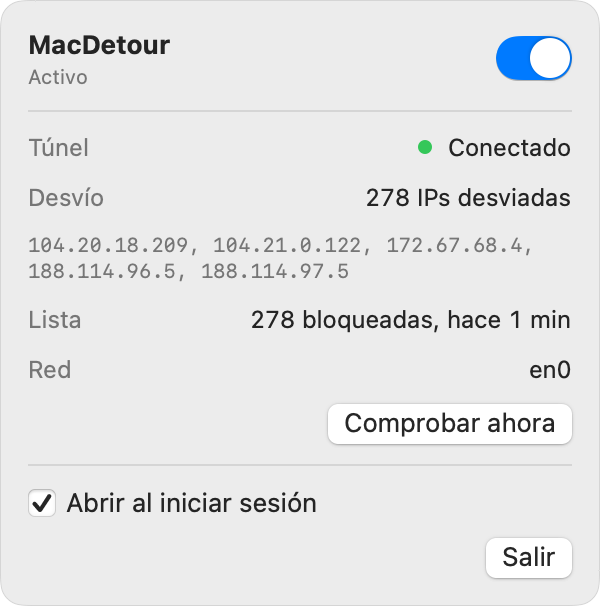

# MacDetour

A menu bar switch that sends only the addresses LaLiga blocks in Spain through
an SSH tunnel to your own server. Everything else keeps using your normal
connection, untouched.

<p align="center">
  <picture>
    <source media="(prefers-color-scheme: dark)" srcset="docs/images/panel-dark.png">
    
  </picture>
</p>

## How it works

```
apps ──▶ macOS routing ──┬─ everything else ─────────────▶ your network
                         └─ blocked IPs only ─▶ utun ─▶ tun2proxy ─▶ ssh -D ─▶ your server ─▶ internet
```

- **What gets detoured.** The daemon downloads the public list of currently
  blocked addresses ([hayahora.futbol](https://hayahora.futbol)) every 5 minutes
  and probes each one directly on TCP 443, through your physical interface. Only
  addresses that do **not** answer directly get a host route into the tunnel. On
  a network without blocks, nothing is detoured.
- **No interruptions.** Connections that work are never touched, because their
  addresses are never routed. Routes are only added while the detour is on,
  never removed, so a refresh cannot cut a connection that is flowing through
  the tunnel. Switching off removes every route at once.
- **Every app is covered**, including command-line tools: it works at the
  routing layer, not with proxy settings.
- **Network changes.** A Wi-Fi or hotspot switch restarts the SSH session at
  once and re-probes the list on the new network.
- **UDP/QUIC** to detoured addresses is not carried (SSH dynamic forwarding is
  TCP only). Browsers fall back to TCP automatically.

## Pieces

| Part | What it does |
|---|---|
| `crates/detour-core` | Config, blocklist parsing, route planning, wire protocol. No OS calls. |
| `crates/detourd` | Root daemon (launchd): SSH supervisor, utun + [tun2proxy](https://github.com/tun2proxy/tun2proxy), routes, probes, control socket `/var/run/macdetour.sock`. |
| `crates/detourctl` | CLI: `detourctl status`, `on`, `off`, `refresh`. |
| `app/` | SwiftUI menu bar app with the on/off switch. |

## Install

```bash
make setup SSH=<your-ssh-alias>      # e.g. make setup SSH=my-server
```

`setup` builds everything, asks for `sudo` once to install the daemon, then uses
your own SSH access to authorize a dedicated tunnel key on the server. That key
is restricted to port forwarding (`restrict,port-forwarding,command="/usr/bin/false"`):
it cannot open a shell or run commands. The daemon never uses your personal key.

The server needs `AllowTcpForwarding yes` (the OpenSSH default).

## Use

Click the menu bar icon and flip the switch, or:

```bash
detourctl on
detourctl status
detourctl off
```

`make probe` shows which listed addresses are blocked on your current network
without changing anything.

Config: `/Library/Application Support/MacDetour/config.toml`. Log: `/var/log/macdetour.log`.

## Uninstall

```bash
make uninstall                     # keeps the key and config
sudo scripts/uninstall.sh --purge  # also deletes them and prints the key to remove from the server
```

## Screenshots

`cd app && swift run RenderScreenshots ../docs/images` renders the panel (light
and dark) and a 1600×900 social card from sample data with the app's real views.

## Tests

```bash
make ci
```

The engine is tested against a fake platform (routing, sticky routes, network
changes, failures, restore after restart); the socket against a fake engine;
the Swift models against the same JSON fixtures as Rust.
